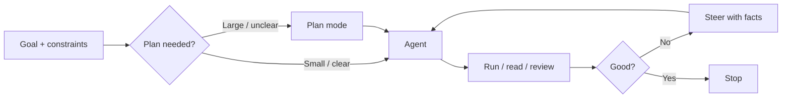
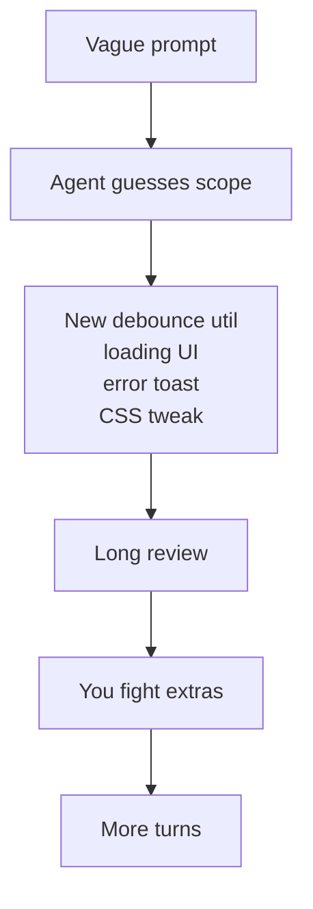
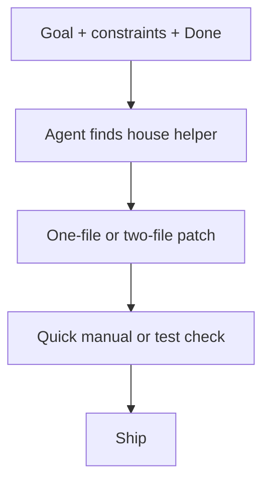
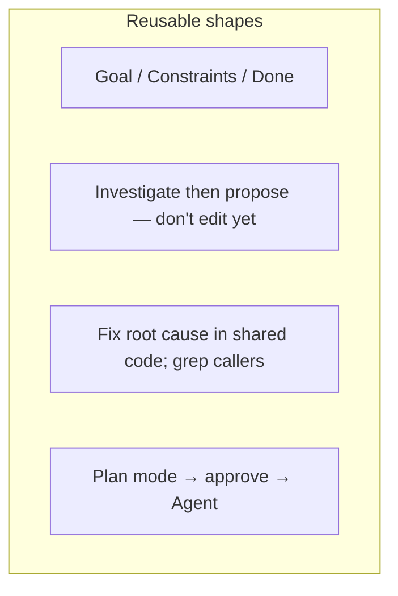
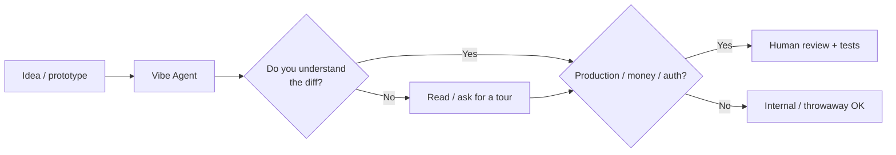

# 01 — Efficient prompting & vibe coding

Vibe coding is fast when the goal is clear and the feedback loop is short. It fails when the agent invents scope, edits the wrong files, or you cannot explain the change. Encode repeats in Rules/Skills; put the goal and constraints in the prompt.

## The efficient loop



| Do | Avoid |
|----|--------|
| Goal, constraints, definition of done | “Make it better” with no target |
| `@` only files/folders you know; else let Agent search | Pasting huge unrelated files |
| One job per message (or `/multitask` for independent jobs) | Five unrelated asks in one blob |
| Plan → Build for multi-file work | Blind Agent on a redesign |
| Review what you ship | Merging unread vibe output |

## Worked example: add debounce to a search box

Imagine a React search input that fires an API call on every keystroke. You want 300 ms debounce, existing helpers preferred, no new dependencies.

### Inefficient interaction

```text
Make the search better and more modern. Also clean up the page and maybe
add loading states and error handling while you're at it.
```



**Typical outcome**

- New utility file even though `lodash/debounce` or a house hook already exists.
- Loading spinner and toast you did not ask for.
- Diff touches styles and unrelated components.
- Three–five follow-ups: “undo the toast”, “use our hook”, “don’t touch CSS”.

### Efficient interaction

```text
Goal: Debounce the search box API calls by 300ms.

Constraints:
- Reuse an existing debounce helper if the repo has one; no new dependency.
- Change only the search input wiring (and a tiny test if one already covers it).
- Do not redesign UI or add loading/error UI.

Done when: typing “abc” triggers one request ~300ms after the last key, and the
diff is limited to that behavior.

@src/components/SearchBox.tsx
```

Optional first step in Plan mode: “Find existing debounce helpers and name the smallest change.”



**Typical outcome**

- Imports `useDebouncedCallback` (or similar) already in the repo.
- One component change; maybe one test assertion.
- Closing note names what was skipped (loading UI, new util).
- Often one turn.

### Side-by-side

| | Inefficient | Efficient |
|---|-------------|-----------|
| Prompt | Mood + many jobs | Goal, constraints, Done |
| Scope | Agent invents features | You capped the blast radius |
| Context | None or noise | One `@` file that matters |
| Turns | Many undo loops | One build + verify |
| Review | Hard | Short diff |

## Prompt patterns that save turns



**Investigate first**

```text
Don't edit yet. Find how search requests are issued and whether a debounce
helper already exists. Reply with file paths and the smallest change option.
```

**Steer mid-flight** (when the agent drifts)

```text
Stop UI work. Keep only the 300ms debounce using the existing helper.
Revert any toast/loading/CSS changes.
```

**Context that helps** — `@Terminals`, `@Commit`, `@Branch`, `@Past Chats`, images for UI bugs. Watch the context ring; Rules and MCP compete for space.

## Vibe coding: when to use it



Great for prototypes and internal tools. Do not ship auth, payments, or data-loss paths you have not read.

## Checklist before you hit Send

1. One primary job?
2. Constraints and Done stated?
3. Right mode (Ask / Plan / Agent / Debug)?
4. Only necessary `@` context?
5. Will you verify (run, click, or test)?

Next: [02 — Customize Agent behavior](02-customize-agent.md).
