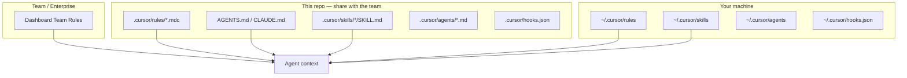
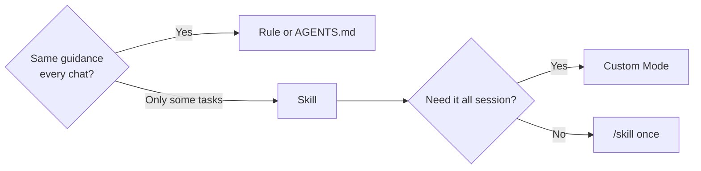
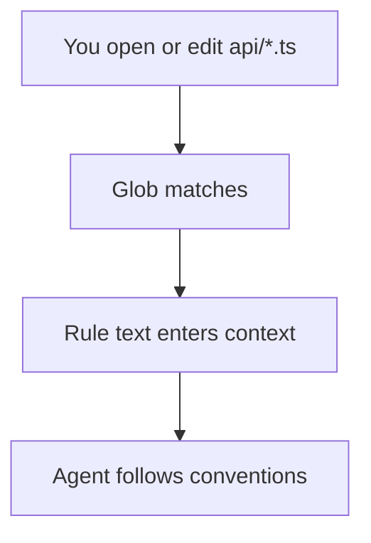
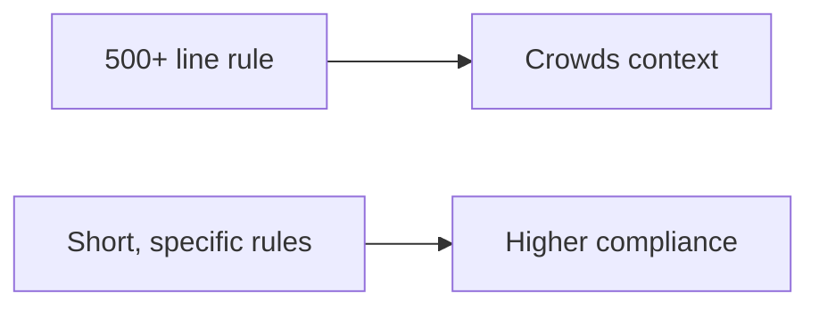

# 02 — Customize Agent behavior

Rules and Skills are how you stop retyping the same instructions. They apply to **Agent chat**, not Tab completions.

## Where customization lives



Precedence for rules: **Team → Project → User**. Nested `AGENTS.md` in a subdirectory overrides a parent for that area.

## Rules vs Skills vs Modes

| Tool | Best for | How it loads |
|------|----------|--------------|
| **Rule** (`.mdc`) | Always-on standards, stack conventions | Always / Intelligent / Glob / Manual `@rule` |
| **`AGENTS.md`** | Simple project instructions | Always, plain markdown |
| **Skill** | Playbook for a job (review, release, migrate) | Auto by `description`, or `/skill-name` |
| **Custom Mode** | Keep a skill for the **whole session** | Invoke skill then **Alt+Enter** (Windows) / **Opt+Enter** (Mac) |



## Create a project rule (practical)

Goal: TypeScript API handlers always validate input at the boundary and never return raw DB errors.

Create `.cursor/rules/api-handlers.mdc`:

```markdown
---
description: API route handler conventions
globs: "**/api/**/*.ts"
alwaysApply: false
---

# API handlers

- Validate request bodies at the handler boundary before business logic.
- Map unknown errors to a generic 500 message; never send stack traces or DB errors to the client.
- Prefer existing error helpers in `src/lib/http.ts` over new wrappers.
```



**Without the rule** — every prompt needs “validate input, don’t leak DB errors…”.  
**With the rule** — a short goal prompt is enough when those files are in play.

### Inefficient vs efficient (same task)

**Inefficient** (no rule, every time):

```text
Add a POST /notes endpoint. Validate the body. Don't leak DB errors. Use
our http helpers. Also follow our naming. Also no any types...
```

**Efficient** (rule already encodes conventions):

```text
Add POST /notes that creates a note for the current user.
Done when: invalid body → 400, success → 201 + id.
@src/api/notes/
```

## User Rules

Cursor Settings → Rules (synced with your account), or files under `%USERPROFILE%\.cursor\rules` (machine-local, not synced). Use User Rules for personal taste (reply style, “always show a test plan”). Keep project conventions in the repo so teammates share them.

## Skills (practical stub)

`.cursor/skills/add-endpoint/SKILL.md`:

```markdown
---
name: add-endpoint
description: Add an HTTP API endpoint using this repo's handler and test patterns.
---

# Add endpoint

1. Find a similar handler and copy its shape.
2. Validate at the boundary; use `src/lib/http.ts`.
3. Add one focused test next to existing API tests.
4. Do not introduce a new framework or middleware layer.
```

Invoke with `/add-endpoint` or let Agent pick it from the description. For a sticky session style, open it as a Custom Mode (**Alt+Enter**).

## Keep rules thin



Prefer several small rules (by glob) over one encyclopedia. Point at files with `@path` in the rule only as a pointer; Cursor does not always inline the whole file.

## Quick commands

| Intent | Action |
|--------|--------|
| New rule | `/create-rule` or add `.cursor/rules/*.mdc` |
| New skill | `/create-skill` |
| Migrate old commands | `/migrate-to-skills` |
| UI hub | Customize → Rules / Skills |

Next: [03 — Multitasking](03-multitasking.md).
