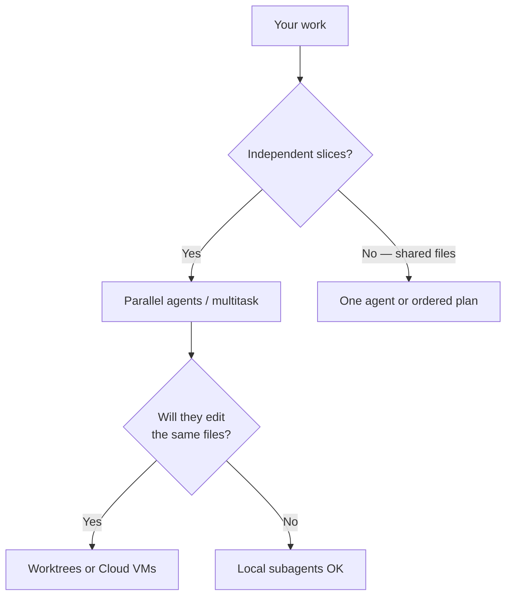
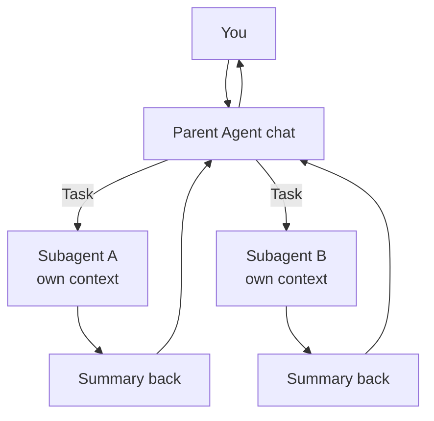
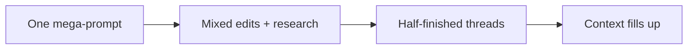
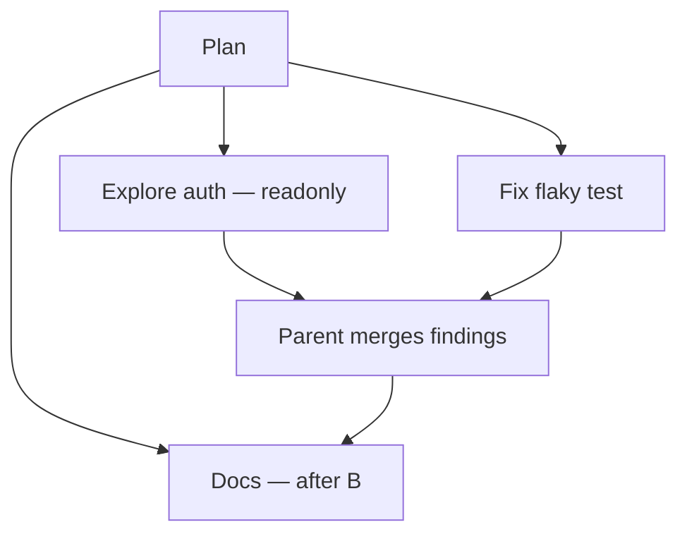
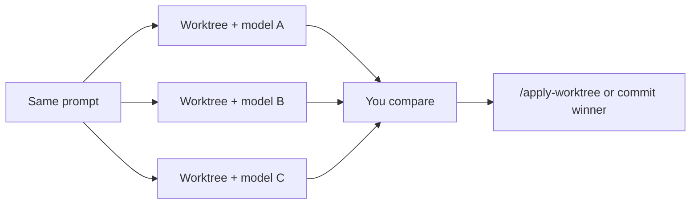
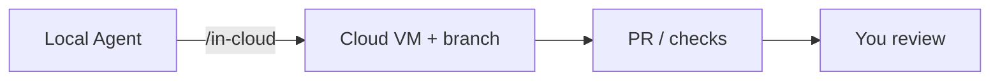

# 03 — Multitasking for better outcomes

One Agent that explores, edits, and reviews in a single context gets crowded and slow. Parallel agents help when work is **independent** or when you want **isolated attempts**.

## When parallelism helps



| Situation | Tool |
|-----------|------|
| “Research X while I implement Y” | Subagents / `/multitask` |
| Plan with independent steps | Plan → **Build in Parallel** |
| Same bug, try several models | `/best-of-n` + worktrees |
| Long job while you stay local | Cloud Agent / `/in-cloud` |
| Many repos / long fleet | Agents Window, Projects |

## Architecture



Subagents do not share the full parent transcript. That protects the main window’s context ring and costs roughly **N× tokens** for N workers.

## Inefficient vs efficient multitasking

### Inefficient — one overloaded chat

```text
Explore the auth module and rewrite the login form and update the docs and
fix the flaky logout test and suggest a security review.
```



**Outcome:** Conflicting edits, shallow research, you cannot tell which part is done.

### Efficient — split by independence

**Chat A (or `/multitask`):**

```text
Explore only: How does logout invalidate sessions? List files and the failure
mode for the flaky test. Do not edit.
```

**Chat B / parallel step:**

```text
Fix the flaky logout test using the findings below. Do not refactor auth.
Done when: the named test passes three times locally.
```

Or from a Plan: mark independent steps and click **Build in Parallel**.



**Outcome:** Cleaner diffs, research does not pollute the implementer’s context, docs wait on the fix.

## `/multitask`

Type `/multitask` so Cursor prefers async parallel subagents instead of queuing your follow-ups behind one long run. Use it when you would otherwise sit idle waiting for unrelated work.

## Worktrees and `/best-of-n`

Parallel editors on the **same** branch overwrite each other. Worktrees give each attempt its own checkout.



Example:

```text
/best-of-n sonnet,gpt,composer Fix the flaky logout test in tests/logout.test.ts.
Do not change production auth code unless the test proves a real bug.
```

`/best-of-n` **compares**; it does not auto-merge. Pick a winner, then apply.

Configure worktree helpers in `.cursor/worktrees.json` when your team standardizes setup (see [Worktrees](https://cursor.com/docs/configuration/worktrees.md)).

## Cloud / background agents



Use for long runs and CI-shaped work. **Move to Cloud** does not take uncommitted local files — commit or stash first. User hooks under `~/.cursor/hooks.json` do **not** run on cloud VMs; project hooks can.

## Agents Window

Cmd/Ctrl+Shift+P → **Open Agents Window**: agent-first UI to run and watch many local/cloud/SSH agents without stuffing one editor chat.

## Practical recipe (better outcome)

1. **Plan** the feature; mark which steps share files.
2. **Parallelize** only independent steps (explore || implement-in-other-package).
3. **Isolate** editors with worktrees or cloud when both write code.
4. **Merge** findings in the parent; one agent applies the final diff.
5. **Review** once on the combined result (or `/review`).

Next: [04 — Harness & hooks](04-hooks-and-harness.md).
