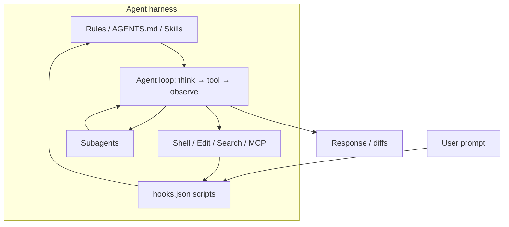
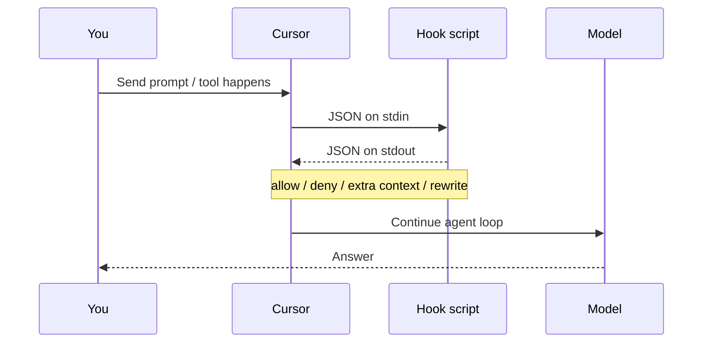
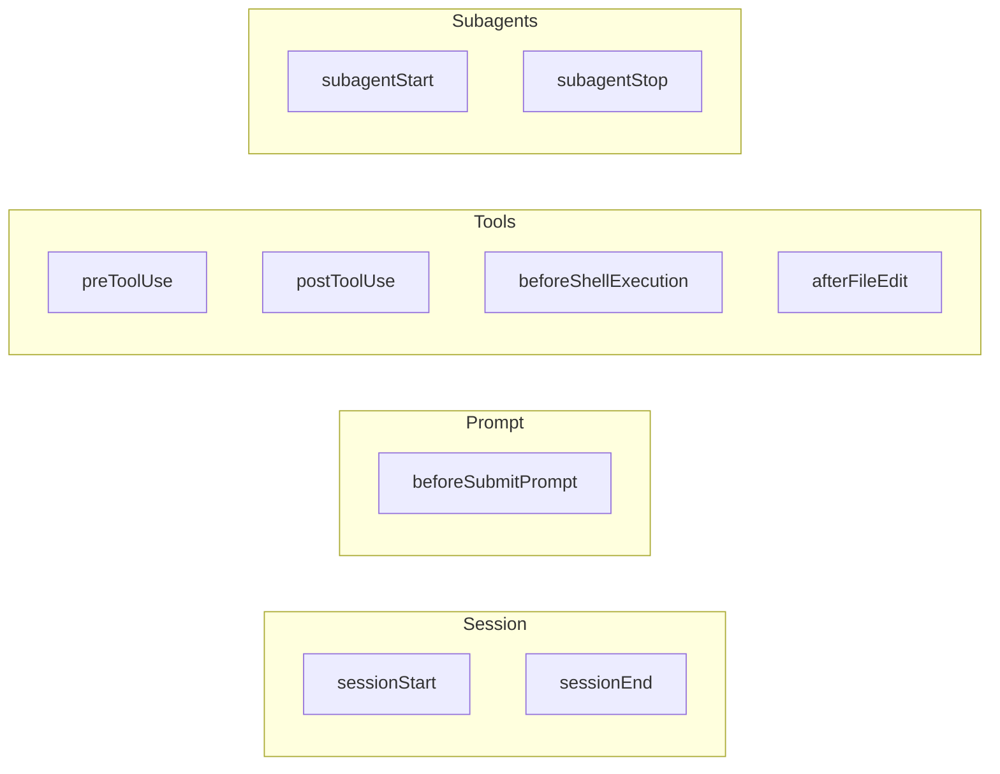
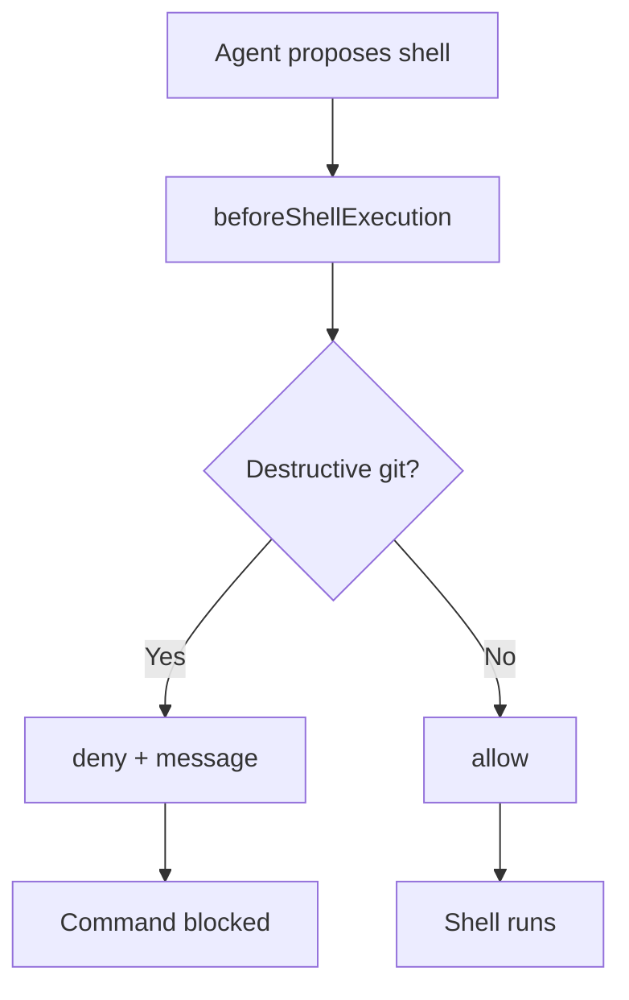

# 04 — Harness & hooks

An **agent harness** is everything around the model that turns a chat into safe, repeatable work: system instructions, tools, MCP, skills, subagents, and lifecycle hooks. You are not changing model weights; you are changing the loop.

## Harness map (Cursor)



| Piece | Role | You edit |
|-------|------|----------|
| Rules / Skills | What to prefer and how to work | `.cursor/rules`, `skills/` |
| Tools / MCP | What the agent can touch | MCP config, permissions |
| Hooks | Observe, block, inject, audit at events | `hooks.json` + scripts |
| Subagents | Specialist loops with own context | `.cursor/agents/*.md` |

Ponytail’s Cursor install is a harness slice: `sessionStart` + `beforeSubmitPrompt` inject a ruleset (see [`../docs/cursor-prompt-pipeline.md`](../docs/cursor-prompt-pipeline.md)).

## Hooks in one picture



- **Project:** `.cursor/hooks.json` (cwd = project root) — share with the repo.  
- **User:** `%USERPROFILE%\.cursor\hooks.json` (cwd = `~/.cursor/`) — all local projects.  
- **Priority:** Enterprise → Team → Project → User. Any **deny** wins.

Exit codes: `0` = use stdout JSON; `2` = deny; other = fail-open unless `failClosed: true`.

## Common events (choose the narrowest)



| Goal | Event |
|------|--------|
| Inject instructions at chat start | `sessionStart` |
| Block secrets in prompts | `beforeSubmitPrompt` |
| Gate `rm -rf` / production deploys | `beforeShellExecution` |
| Format or audit after edits | `afterFileEdit` |
| Allow/deny Task subagents | `subagentStart` |
| Audit every tool | `preToolUse` / `postToolUse` |

Full list: [Hooks docs](https://cursor.com/docs/hooks). Create via `/create-hook`.

## Minimal project hook (practical)

Deny destructive git resets from Agent:

`.cursor/hooks.json`:

```json
{
  "version": 1,
  "hooks": {
    "beforeShellExecution": [
      {
        "command": "node .cursor/hooks/deny-destructive-git.js",
        "timeout": 10
      }
    ]
  }
}
```

`.cursor/hooks/deny-destructive-git.js` (sketch):

```javascript
const fs = require('fs');
const input = JSON.parse(fs.readFileSync(0, 'utf8'));
const cmd = String(input.command || input.commandLine || '');
const bad = /git\s+reset\s+--hard|git\s+push\s+--force/.test(cmd);
if (bad) {
  process.stdout.write(JSON.stringify({
    permission: 'deny',
    user_message: 'Blocked destructive git command from Agent.'
  }));
} else {
  process.stdout.write(JSON.stringify({ permission: 'allow' }));
}
```

Exact field names can vary by Cursor version — generate a stub with `/create-hook` or copy from the [hooks docs](https://cursor.com/docs/hooks) sample for your event. Check **Customize → Hooks** and the Hooks output channel when debugging.



## Modify an existing harness (Ponytail example)

You already have user hooks pointing at this checkout:

```text
sessionStart        → hooks/ponytail-activate.js
beforeSubmitPrompt  → hooks/ponytail-mode-tracker.js
```

| Change | Action |
|--------|--------|
| Wording of rules | Edit `skills/ponytail/SKILL.md` (hooks re-read it) |
| Default level | `/ponytail default lite` or `%APPDATA%\ponytail\config.json` |
| Stop hooks in one repo | Keep `.cursor/rules/ponytail.mdc` **or** uninstall hooks |
| Uninstall | `node scripts/cursor-hooks.js uninstall` from this repo |

Do not layer a second conflicting “always be maximal” Always rule on top of Ponytail; pick one personality per workspace.

## Inefficient vs efficient harness use

| Inefficient | Efficient |
|-------------|----------|
| Paste a 2-page policy every prompt | Rule or `sessionStart` injection once |
| Hope the model never runs `git reset --hard` | `beforeShellExecution` deny |
| One god-prompt for style + security + API | Thin rules by glob + a security skill |
| Debug hooks by guessing | Hooks channel + tiny script that logs input |

## Cloud caveats

- User `~/.cursor/hooks.json` does **not** run on Cloud Agent VMs.  
- Prefer **project** hooks for team/cloud.  
- Managed cloud agents may skip `sessionStart` / `sessionEnd`.

## “Define a harness” checklist

1. **Instructions:** Rules + `AGENTS.md` for always-on; Skills for playbooks.  
2. **Tools:** Only the MCP servers you need.  
3. **Guards:** Hooks for deny/audit at trust boundaries.  
4. **Experts:** Subagents for isolated specialties ([05](05-expert-agents.md)).  
5. **Verify:** One real Agent turn; confirm Hooks log and behavior.

Next: [05 — Experts from one model](05-expert-agents.md).
