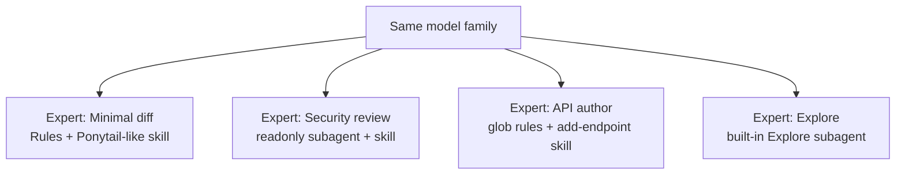
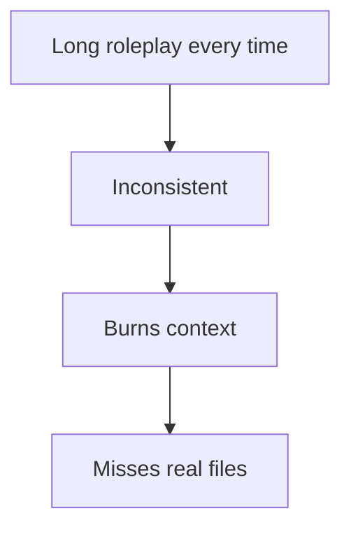
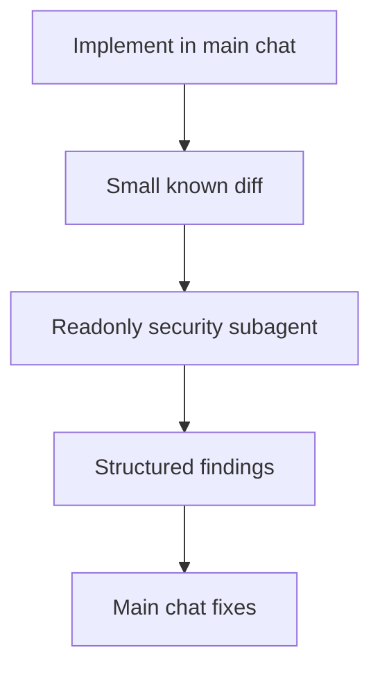
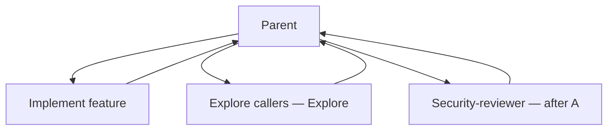
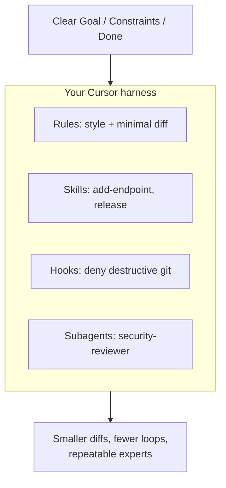

# 05 — Experts from the same model

You do not need fine-tuning to get “a reviewer,” “a security skeptic,” or “a minimal-diff engineer.” You change **instructions**, **tools**, and **context isolation**. The weights stay the same; the expert is a harness profile.

## Expert = profile, not a new brain



| Mechanism | Isolation | Sticky? | Best for |
|-----------|-----------|---------|----------|
| Rule / `AGENTS.md` | Shared chat context | Always / when matched | Team conventions |
| Skill | Attached when relevant | One message (or Custom Mode) | Playbooks |
| Custom Mode | Whole session | Yes | “Stay in reviewer voice” |
| Custom Subagent | **Own** context window | Per Task | Long specialty + parallel |
| Built-in Explore / Browser | Own context | Per Task | Research / UI |

Prefer a **Skill** for a one-shot recipe. Prefer a **Subagent** when you need a clean context or parallel verification ([Subagents](https://cursor.com/docs/subagents.md)).

## Build three experts (practical)

### 1) Minimal-diff engineer (Rule + Skill)

`.cursor/rules/minimal-diff.mdc`:

```markdown
---
description: Prefer the smallest complete change
alwaysApply: true
---

# Minimal diff

Solve the whole task with the least new code. Reuse repo helpers. No features
nobody asked for. End with what you skipped and any risk.
```

Optional: keep Ponytail hooks for level switching, **or** this rule — not both fighting in one workspace.

### 2) Security reviewer (Subagent)

`.cursor/agents/security-reviewer.md`:

```markdown
---
name: security-reviewer
description: Reviews diffs for auth, injection, secrets, and data exposure. Use after implementing features that touch auth, payments, or user input.
model: inherit
readonly: true
---

You are a security reviewer. Do not implement features.

Check for: missing authz, injection, secret leakage, unsafe shell, over-broad CORS,
trusting client input. For each finding: severity, file, what goes wrong, fix.

If nothing material: say "No material security findings" and list residual risks.
```

Invoke with `/security-reviewer` or ask the parent Agent to delegate after a feature lands. `readonly: true` keeps it from “fixing” while reviewing.

### 3) Endpoint author (Skill)

`.cursor/skills/add-endpoint/SKILL.md` — see [02](02-customize-agent.md). Invoke `/add-endpoint` when adding routes.


## Inefficient vs efficient “experts”

### Inefficient — roleplay in every prompt

```text
You are a senior security engineer with 20 years experience at ... also be
concise ... also follow our style ... also don't break tests ...
[paste 80 lines of policy]
Now review this entire codebase.
```



**Outcome:** Inconsistent depth, no reuse, no isolation from the implementation chat.

### Efficient — named expert + scoped job

```text
Implement POST /notes as discussed. Stay minimal-diff.

When the diff is ready, run the security-reviewer subagent on only the files you
changed. Fix any high/medium findings; list lows.
```

Or manually:

```text
/security-reviewer
Review the current branch diff for the notes endpoint only.
```



**Outcome:** Implementation context stays clean; review gets a fresh window; policy lives in `.cursor/agents/`, not in your memory.

## Custom Mode as a sticky expert

1. Type `/` and select a skill (e.g. your review skill).  
2. Press **Alt+Enter** (Windows) / **Opt+Enter** (Mac) to keep it for the session.  
3. Work in that voice until you leave the mode.

Good for “all replies today are API design critiques.” Less good for parallel work — use subagents there.

## Wiring experts into multitask



Ask for parallel only when A and B do not edit the same files. Run security **after** implementation, or on a worktree copy.

## Create helpers

| Need | Command / path |
|------|----------------|
| New subagent | `/create-subagent` → `.cursor/agents/*.md` |
| New skill | `/create-skill` |
| New rule | `/create-rule` |
| New hook guard | `/create-hook` |

## Expert roster template

Copy and fill for your team:

| Expert | Type | Trigger | Readonly? | Notes |
|--------|------|---------|-----------|-------|
| Minimal diff | Always rule | every chat | n/a | Conflicts with “build big” vibes |
| Add endpoint | Skill | `/add-endpoint` | no | |
| Security review | Subagent | after auth/pay features | yes | |
| Explore | Built-in | research | yes | |

## Put it together



1. Prompt efficiently ([01](01-efficient-prompting.md)).  
2. Encode repeats ([02](02-customize-agent.md)).  
3. Parallelize independent work ([03](03-multitasking.md)).  
4. Guard the loop ([04](04-hooks-and-harness.md)).  
5. Name your experts (this page).

Back to the [Tutorial index](README.md).
