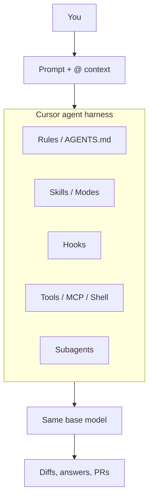

# Cursor Agent Efficiency Tutorial

A practical guide to shaping Agent behavior in Cursor, prompting with less waste, running work in parallel, and turning one model into several “experts” with rules, skills, hooks, and subagents.

## Who this is for

You already chat with Agent. You want fewer rewrite loops, clearer diffs, and a setup that travels with you across projects.

## Map

| Guide | What you learn |
|-------|----------------|
| [01 — Efficient prompting & vibe coding](01-efficient-prompting.md) | Inefficient vs efficient prompts, with a worked example and outcome diagrams |
| [02 — Customize Agent behavior](02-customize-agent.md) | Rules, `AGENTS.md`, Skills, Custom Modes — where files live and when each applies |
| [03 — Multitasking](03-multitasking.md) | `/multitask`, subagents, worktrees, `/best-of-n`, Cloud Agents |
| [04 — Harness & hooks](04-hooks-and-harness.md) | What an agent harness is, how to write/modify hooks, safety |
| [05 — Experts from one model](05-expert-agents.md) | Build review / security / UI specialists without fine-tuning |

## Mental model

The model weights stay the same. The harness changes what it sees, what it is allowed to do, and which specialist loop runs.

## 30-minute path

1. Read [01](01-efficient-prompting.md) and redo one of your last chats using the efficient pattern.
2. Add one Always or Glob rule from [02](02-customize-agent.md) for a convention you retype often.
3. Run one parallel task from [03](03-multitasking.md) (explore + implement, or `/best-of-n` on a small fix).
4. Skim [04](04-hooks-and-harness.md) and [05](05-expert-agents.md); add a hook or a subagent only when a pain repeats.

## Official docs

- [Rules](https://cursor.com/docs/rules)
- [Skills](https://cursor.com/docs/skills)
- [Hooks](https://cursor.com/docs/hooks)
- [Subagents](https://cursor.com/docs/subagents)
- [Multi-agent](https://cursor.com/help/ai-features/multi-agent)
- [Prompting](https://cursor.com/docs/agent/prompting)
- [Vibe coding](https://cursor.com/help/ai-features/vibe-coding)

If you installed Ponytail for Cursor, its prompt pipeline is documented in [`../docs/cursor-prompt-pipeline.md`](../docs/cursor-prompt-pipeline.md). This tutorial is about Cursor itself; Ponytail is one optional ruleset inside the harness.
