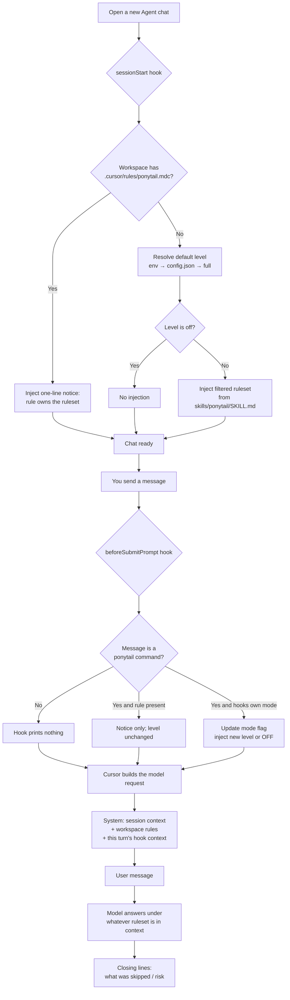
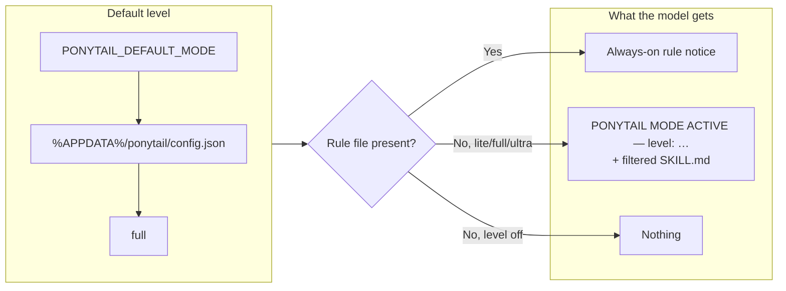
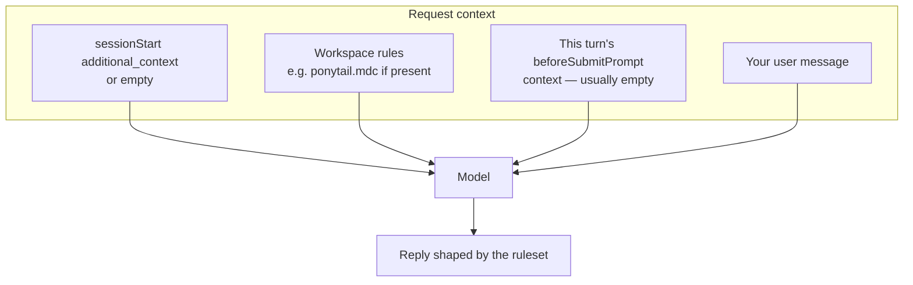
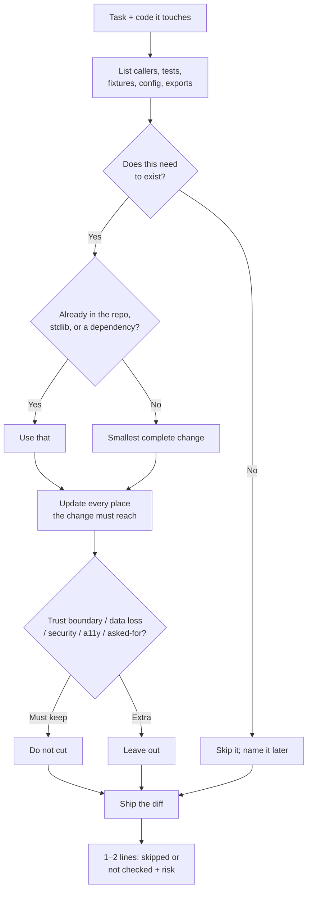
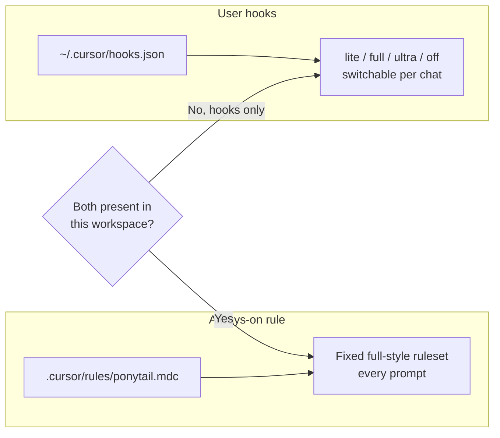
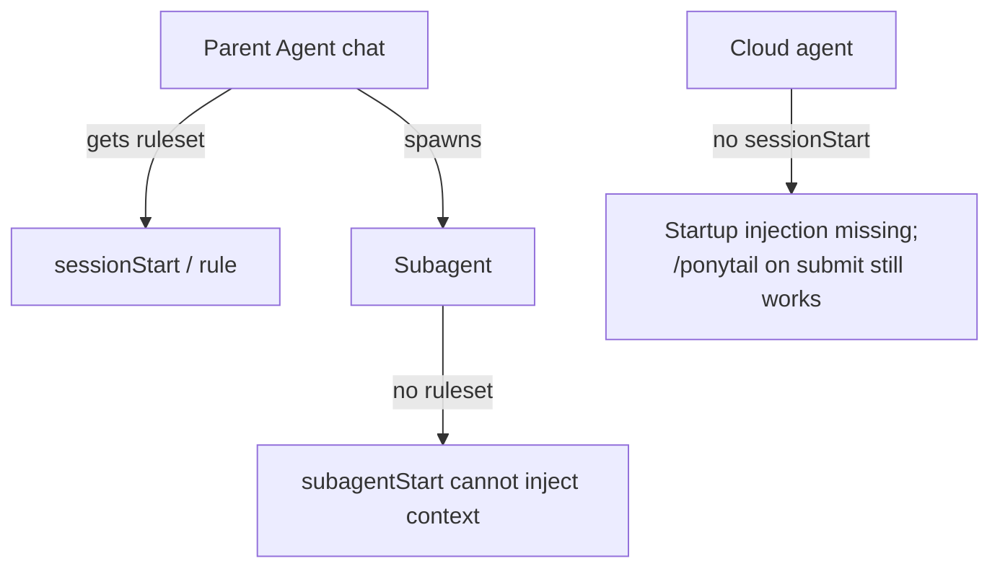

# How Ponytail shapes a Cursor prompt

This is the Cursor path only: user-level hooks in `~/.cursor/hooks.json`, plus the optional always-on rule `.cursor/rules/ponytail.mdc`. Other agents use different loaders; see [agent-portability.md](agent-portability.md) and [cursor-hooks.md](cursor-hooks.md).

Ponytail does not rewrite your prompt. It adds instruction context before the model answers, and those instructions change what the model chooses to build and how it replies.

## End-to-end pipeline



## 1. Chat start — `sessionStart`

Runs once when the conversation is created. Its `additional_context` is stored on the chat and sent with every later request.



| Outcome | Injected text |
|---------|----------------|
| Rule file in workspace | Notice that the rule owns behavior; mode commands will not switch levels |
| Hooks own mode, level `off` | Empty |
| Hooks own mode, `lite` / `full` / `ultra` | Header + `SKILL.md` with only that level’s table row kept |

## 2. Each message — `beforeSubmitPrompt`

Runs on every send. Ordinary coding prompts pass through unchanged. Mode commands are plain messages; Cursor has no built-in `/ponytail` command.

```mermaid
flowchart TD
  M[Your message] --> P{Parse}
  P -->|/ponytail lite\|full\|ultra| S[Set live level<br/>inject MODE CHANGED + ruleset]
  P -->|/ponytail off<br/>stop ponytail<br/>normal mode| O[Clear flag<br/>inject MODE OFF]
  P -->|/ponytail| R[Report current level]
  P -->|/ponytail default &lt;level&gt;| D[Write config.json default]
  P -->|Anything else| X[No hook output]

  S --> Note{Rule file present?}
  O --> Note
  R --> Note
  D --> Note
  Note -->|Yes| N[Replace with coexistence notice;<br/>do not change the flag]
  Note -->|No| Apply[Deliver hook JSON to Cursor]
  X --> Model[Model request continues]
  N --> Model
  Apply --> Model
```

`MODE OFF` does not erase the ruleset already stored from `sessionStart`. The notice tells the model to stop applying it for the rest of the chat.

## 3. What reaches the model on a normal coding turn



In this ponytail checkout, `WR` already contains the compact ruleset, so hooks stay quiet. In a normal project with only the user-level hooks installed, `SC` carries the filtered skill and `WR` has no ponytail rule.

## 4. How the ruleset changes the answer

Once the ruleset is in context, the model is steered before it writes code. This is instruction-following, not a separate compiler pass.



### Levels

| Level | Extra pressure on the same pipeline |
|-------|-------------------------------------|
| **lite** | Build what was asked; name a smaller option in one line and let you pick |
| **full** | Default: smallest complete change, check where logic needs one, closing skip/risk lines |
| **ultra** | Before building, push back on any part the need does not justify |

### What “skipped” means here

Not a task queue. Two things land in the closing lines:

1. **Work left out on purpose** — features, options, wrappers, config, and flexibility nobody asked for.
2. **Checks not run** — tests not executed, files not opened, installs not verified.

Never listed as skippable: callers/tests/fixtures the change breaks, validation at trust boundaries, error handling that prevents data loss, security, accessibility, hardware calibration, and anything you asked for.

A known limit that still ships goes in code as `shortcut: <limit>, <when to upgrade>` (debt for `/ponytail-debt`), not only in the reply footer.

## 5. Rule vs hooks (pick one)



They are alternatives, not layers. Delete the rule in a workspace when you want `/ponytail lite` and friends to work there.

## 6. Gaps in the Cursor path



## Quick check in a project

1. Prefer a project **without** `.cursor/rules/ponytail.mdc`.
2. Open a **new** Agent chat.
3. Ask: *Quote the first line of any ponytail context you were given.*
4. Expect something like `PONYTAIL MODE ACTIVE — level: full` (or your configured default).
5. Send `/ponytail lite`, then ask again; expect `PONYTAIL MODE CHANGED — level: lite`.

In the Hooks output channel under Customize, each `sessionStart` / `beforeSubmitPrompt` run shows whether the scripts printed JSON or stayed silent.
